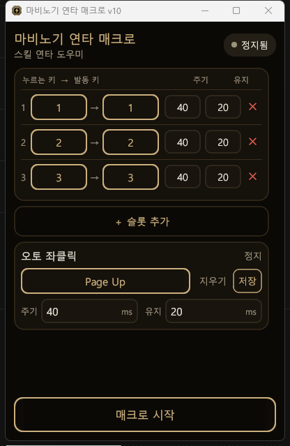

# 마비노기 연타 매크로 (Go)

마비노기에서 스킬 키를 "누르고 있으면" 해당 대상 키를 초고속으로 반복 입력해 주는 고성능 연타 매크로입니다. (개발사 허용 범위 내 사용)

<p align="center">
  
</p>

## 1. 주요 특징

* **다중 키 동시 연타 (슬롯 동적 추가/삭제)**: 슬롯마다 *누르는 키(트리거)* → *발동 키(대상)* 를 지정하고, 인게임에서 트리거들을 동시에 누르면 각자의 속도로 완전히 분리(비동기)되어 섞여 연타됩니다. 기본 3슬롯이며 **＋ 슬롯 추가 / 삭제** 로 최대 10개까지 자유롭게 조절합니다.
* **연타주기 · 유지시간 분리 설정**: `연타주기(ms)`는 한 번 발동하는 간격, `유지시간(ms)`은 키를 눌러 유지하는 길이입니다. 스킬이 안 터지면 유지시간을 조금씩 올려서 게임 반응에 맞춥니다.
* **키보드 + 마우스 전 버튼 지원**: 트리거·대상 모두 키보드 키는 물론 **좌·우·휠·X1·X2 마우스 버튼**까지 지정할 수 있습니다. 방향키/넘패드 같은 확장 키도 올바른 스캔코드로 전송됩니다.
* **오토 좌클릭 (독립 토글)**: 지정한 트리거 키로 켜고 끄는 별도 자동 좌클릭. 켜면 1초 후 시작됩니다. 슬롯 트리거와 키가 겹치면 시작 시 경고합니다.
* **설정 자동 저장**: 슬롯 구성·주기·유지 값은 `%LOCALAPPDATA%\MabinogiMacro\config.json`에 보관됩니다. 실행 파일 하나만 들고 다녀도 세팅이 유지됩니다.
* **물리 키 충돌 방지**: 트리거 키의 실제 물리 입력은 OS 단(입력 가로채기)에서 차단하고 합성 입력만 게임에 보내, 눌림 오인으로 입력이 씹히는 현상을 방지합니다.
* **단일 실행 파일 · 런타임 불필요**: 순수 Go로 빌드된 포터블 exe입니다. 별도 설치나 프레임워크가 필요 없습니다.

## 2. 사용 방법

1. `마비노기 키 다운 - v14.0.0.exe` 를 더블클릭합니다.
   > [!IMPORTANT]
   > 게임 내 입력이 씹히면 안티치트가 일반 권한 프로세스를 차단하는 상태입니다. 이 앱은 실행 시 **자동으로 관리자 권한(UAC)** 을 요청하도록 설계되어 있으니 '예'를 눌러주세요.
2. 슬롯의 **누르는 키 / 발동 키** 를 각각 클릭 → 원하는 키(또는 마우스 버튼)를 눌러 지정합니다. `＋ 슬롯 추가` / `✕` 로 슬롯 개수를 조절할 수 있습니다.
3. **연타주기 / 유지시간** 을 조정합니다.
4. 하단 **[매크로 시작]** 을 누릅니다.
5. 게임에서 지정한 트리거 키를 꾹 누르면 대상 키가 연타되고, 떼면 즉시 멈춥니다.

> **팁 — 추천 시작값:** `연타주기 50ms / 유지 20ms`. 스킬이 안 터지면 유지를 25~30으로 올리고, 더 빠르게 원하면 주기를 40→30으로 내려가며 실제로 더 자주 터지는 지점까지만 낮추세요. 주기를 30ms 밑으로 내리면 게임 프레임 한도로 무시되어 효과 없이 CPU만 더 씁니다.
>
> ※ *누르는 키와 발동 키를 같은 키로 두어도 안전합니다* (예: `1 → 1` = 1을 누르는 동안 1을 초고속 연타). 물리 입력은 차단되고 합성 입력만 전달됩니다.

## 3. 구조 (개발자용)

순수 Go 기반이며, GUI는 **Gio**(`gioui.org`), 입력/훅은 **Win32 API 직접 호출**(`golang.org/x/sys/windows`)로 구현되어 있습니다.

* `main.go`: Gio 기반 UI. **다크 골드(웜 블랙 + 샴페인 골드) 테마**, 표(row) 형태의 컴팩트 슬롯 목록, 상태 표시, 키 바인딩. 한글 표시를 위해 시스템 맑은 고딕(`malgun.ttf`)을 폰트로 로드합니다(없으면 기본 폰트로 폴백).
* `config.go`: 슬롯/오토클릭 설정을 `RWMutex`로 스레드 안전하게 관리하고 `config.json`을 읽고 씁니다. `DelayMs`(주기)와 `DownMs`(유지)를 분리 저장하며, 슬롯 개수는 가변입니다.
* `hook.go`: 핵심 로직. `WH_KEYBOARD_LL`/`WH_MOUSE_LL` 훅을 **전용 OS 스레드 + 자체 메시지 루프**에 설치해 GUI 툴킷과 무관하게 안정 동작합니다. 슬롯별로 독립 `goroutine`을 생성/소멸하며 각자 속도로 입력을 반복합니다.
* `input.go`: `user32.dll`의 `SendInput`을 래핑해 스캔코드/마우스(좌·우·휠·X1·X2) 이벤트를 전송합니다. 확장 키는 `KEYEVENTF_EXTENDEDKEY`로 보정합니다.
* `winicon.go`: exe에 임베드된 아이콘을 실행 시 창(타이틀바·작업표시줄)에 직접 설정합니다. Gio가 리소스 ID 1 아이콘만 자동 로드하는 제약을 우회합니다.
* `icon.ico` / `rsrc.syso`: 앱 아이콘(골드 메달리온)과 관리자 권한 매니페스트를 컴파일해 exe에 임베드합니다.

### 빌드

C 컴파일러가 필요 없습니다(순수 Go). GUI 뒤에 콘솔 창이 뜨지 않도록 `-H windowsgui` 플래그를 씁니다.

```powershell
go build -ldflags="-H windowsgui" -o "마비노기 키 다운 - v14.0.0.exe"
```

`build.bat`을 쓰면 출력 파일명을 인자로 넘길 수 있습니다.

```powershell
.\build.bat "마비노기 키 다운 - v14.0.0.exe"
```

#### 아이콘 · 매니페스트 재생성

아이콘(`icon.ico`)이나 매니페스트(`app.manifest`)를 바꿨다면 리소스 오브젝트를 다시 만든 뒤 빌드하세요.

```powershell
go install github.com/akavel/rsrc@latest
rsrc -arch amd64 -manifest app.manifest -ico icon.ico -o rsrc.syso
```
